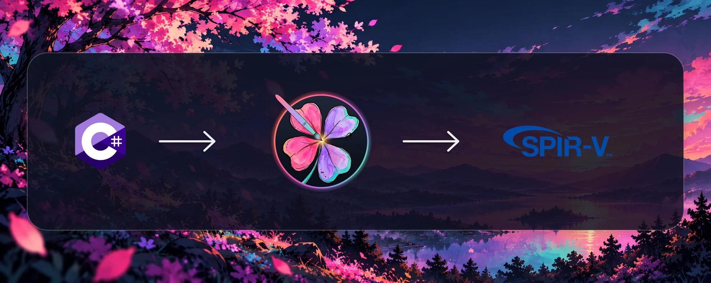

<p align="center">
  
</p>

<h1 align="center">YotsubaShader</h1>

<p align="center">
  A C# shader language for teams that want to write once, use familiar conventions, and compile for the backend they choose.
</p>

<p align="center">
  <a href="https://yotsubashader.com">Website</a> ·
  <a href="https://yotsubashader.com/documentation/">Documentation</a> ·
  <a href="https://yotsubashader.com/playground/">Playground</a> ·
  <a href="https://github.com/KMemphis/YotsubaShader">Repository</a>
</p>

## The product

YotsubaShader is the shader authoring layer for your engine, framework, or content tool. Your team writes shaders in C# using types, structures, and attributes. The compiler interprets their interfaces and stages, lowers the supported shader subset to a shared intermediate representation, and generates output for the selected backend.

The central idea is simple: **the attribute style you use does not determine the output target**. HLSL, GLSL, Metal, Vulkan, and WGSL provide equivalent authoring vocabularies. Choose the one your team knows best, then select SPIR-V or another backend when compiling. WGSL-style authoring is available; WGSL output itself remains planned.

```text
C# with familiar attributes
          ↓
semantic analysis and validation
          ↓
Yotsuba IR
          ↓
SPIR-V · HLSL · GLSL · GLSL ES · MSL · C++
```

## Why YotsubaShader

- Write shaders alongside your C# code using your project's structures, types, and conventions.
- Keep the shader vocabulary your team already knows.
- Describe inputs, outputs, resources, locations, bindings, and stages explicitly.
- Choose the output backend independently of the authoring style.
- Integrate compilation into CI, a content tool, or your engine's build process.

## One shader, five authoring styles

The five examples below express the same basic intent: declare a vertex shader and identify its GPU position output. Some also show how each vocabulary names the built-in vertex index.

> An HLSL-like style does not require an HLSL target, and a WGSL-like style does not require WebGPU. These are C# authoring choices; the compilation target is selected separately.

### HLSL-like code style: a familiar color shader

The HLSL-like style is a good place to start because the relationship between stages, inputs, position, and fragment color is easy to see. This example receives a position and color for each vertex, passes the color through, and returns it from the fragment stage.

```csharp
using Microsoft.Xna.Framework;
using YotsubaShader.Language;
using YotsubaShader.HlslSyntax; // Attribute names inspired by HLSL.

public struct VertexInput
{
    [POSITION]
    public Vector2 Position;

    [COLOR]
    public Vector4 Color;
}

public struct VertexOutput
{
    [SV_Position]
    public Vector4 Position;

    [COLOR]
    public Vector4 Color;
}

public class BasicColorShader
{
    [ShaderStage(Stage.Vertex)]
    public VertexOutput Vertex(VertexInput input)
    {
        VertexOutput output = new VertexOutput();

        output.Position = new Vector4(
            input.Position.X,
            input.Position.Y,
            0.0f,
            1.0f
        );

        output.Color = input.Color;

        return output;
    }

    [ShaderStage(Stage.Fragment)]
    [return: SV_Target(0)]
    public Vector4 Fragment(VertexOutput input)
    {
        return input.Color;
    }
}
```

This small shader shows the essential pieces of the language:

- `VertexInput` defines the data supplied by the engine.
- `[POSITION]` and `[COLOR]` identify the HLSL-style vertex semantics supplied by the engine.
- `VertexOutput` defines what the vertex shader passes to the next stage.
- `[SV_Position]` marks the position required by the GPU.
- `[ShaderStage]` identifies the vertex and fragment stages.
- `[COLOR]` carries color between those stages.
- `[SV_Target(0)]` identifies the first render-target output of the fragment stage.

The same class can grow to include uniforms, textures, buffers, and other stages. These HLSL-style semantics describe the shader interface; the output backend is chosen when compiling.

### GLSL-like code style

```csharp
using Microsoft.Xna.Framework;
using YotsubaShader.Language;
using YotsubaShader.GlslSyntax; // Attribute names inspired by GLSL.

public struct VertexOutput
{
    [gl_Position]
    public Vector4 Position;
}

public class Triangle
{
    [ShaderStage(Stage.Vertex)]
    public VertexOutput Vertex([gl_VertexIndex] uint vertexIndex)
    {
        VertexOutput output = new VertexOutput();
        output.Position = new Vector4(0.0f, 0.0f, 0.0f, 1.0f);
        return output;
    }
}
```

### Metal-like code style

```csharp
using Microsoft.Xna.Framework;
using YotsubaShader.Language;
using YotsubaShader.MslSyntax; // Attribute names inspired by Metal Shading Language.

public struct VertexOutput
{
    [position]
    public Vector4 Position;
}

public class Triangle
{
    [ShaderStage(Stage.Vertex)]
    public VertexOutput Vertex([vertex_id] uint vertexId)
    {
        VertexOutput output = new VertexOutput();
        output.Position = new Vector4(0.0f, 0.0f, 0.0f, 1.0f);
        return output;
    }
}
```

### Vulkan-like code style

```csharp
using Microsoft.Xna.Framework;
using YotsubaShader.Language;
using YotsubaShader.SpirvSyntax; // Attribute names inspired by Vulkan/SPIR-V.

public struct VertexOutput
{
    [BuiltIn_Position]
    public Vector4 Position;
}

public class Triangle
{
    [ShaderStage(Stage.Vertex)]
    public VertexOutput Vertex([BuiltIn_VertexIndex] uint vertexIndex)
    {
        VertexOutput output = new VertexOutput();
        output.Position = new Vector4(0.0f, 0.0f, 0.0f, 1.0f);
        return output;
    }
}
```

### WGSL-like code style

```csharp
using Microsoft.Xna.Framework;
using YotsubaShader.Language;
using YotsubaShader.WgslSyntax; // Attribute names inspired by WGSL.

public struct VertexOutput
{
    [@builtin_position]
    public Vector4 Position;
}

public class Triangle
{
    [ShaderStage(Stage.Vertex)]
    public VertexOutput Vertex([@builtin_vertex_index] uint vertexIndex)
    {
        VertexOutput output = new VertexOutput();
        output.Position = new Vector4(0.0f, 0.0f, 0.0f, 1.0f);
        return output;
    }
}
```

These names deliberately resemble their source languages. In C#, WGSL-inspired attributes use `@` in the identifier, as in `[@builtin_position]`, while remaining valid C#.

## Interfaces and resources

You can describe interfaces and resources with attributes from the syntax you are using. In the HLSL-style vocabulary, `[POSITION]` and `[COLOR]` describe vertex semantics, while resource declarations use `YotsubaShader.HlslSyntax.Resources`. Explicit numbered locations are provided separately by `YotsubaShader.SpirvSyntax` through `[Location(n)]`. Each `YotsubaShader.{Language}Syntax` project (`GlslSyntax`, `HlslSyntax`, `MslSyntax`, `SpirvSyntax`, `WgslSyntax`) is an optional vocabulary built on the shared `YotsubaShader.Language` stage and type model.

```csharp
using Microsoft.Xna.Framework;
using YotsubaShader.Language;
using YotsubaShader.HlslSyntax;
using YotsubaShader.HlslSyntax.Resources;

public struct VertexInput
{
    [POSITION]
    public Vector2 Position;

    [COLOR]
    public Vector4 Color;
}

public sealed class Material
{
    public float Exposure;
}

public class Lighting
{
    [cbuffer]
    [register(RegisterPrefix.b, 0)]
    public Material Material;
}
```

Here the input semantics use the HLSL-style names, and `Lighting.Material` is bound as a constant buffer at register `b0`. The equivalent interface and resource declarations use the corresponding vocabulary when you choose GLSL, MSL, SPIR-V, or WGSL.

## Compiling to SPIR-V

### Compilation CLI

The repository includes a CLI for builds, CI, and content tools. It opens the supplied `.csproj`, discovers shader entry points marked with `[ShaderStage]`, compiles them, and writes the selected targets to the output directory.

```bash
dotnet run --project YotsubaShader.CLI/YotsubaShader.CLI.csproj -- \
  compile Game.Graphics.csproj \
  --target spirv \
  --output artifacts/
```

The CLI supports SPIR-V, HLSL, GLSL, GLSL ES, Metal, and C++ output, plus compiled effects for game engines through [ShadowDusk](ShadowDusk/): `mgfx` (MonoGame), `kni` (KNI WebGL), and `fna` (FNA). Repeat `--target` to generate several targets in one invocation. `--target` selects the backend independently of the attributes used to write the shader.

The engine targets write one binary per shader instead of one file per stage:

| `--target` | Output | Produced by |
|---|---|---|
| `mgfx` | `Shader.<platform>.mgfx`, one file per `MonoGamePlatform` (`desktopgl`, `windowsdx11`, `windowsdirectx12`, `desktopvulkan`, `ios`, `android`, `gl4`) | `ToMGFX(platform)` |
| `kni` | `Shader.knifx` | `ToKNIWebGL_FX()` |
| `fna` | `Shader.fxb` | `ToFNA_FX()` |

These targets compile the vertex and fragment stages through ShadowDusk, which needs its native DXC and vkd3d-shader libraries. They are not in the repository: run `ShadowDusk/tools/restore.sh` once (it downloads them and verifies their SHA-256) before using them. If one binary fails to compile, the CLI reports the reason, keeps going with the others, and exits with code 1. Compilation is verified for the example shaders; rendering them on each engine is not covered yet. The current compiler path covers the `Vertex`, `Fragment`, and `Compute` stages and the supported subset of shader-body operations.

### Generated project accessors

Use the `add` command when the project should contain a visible generated C# file instead of only external shader artifacts:

```bash
dotnet run --project YotsubaShader.CLI/YotsubaShader.CLI.csproj -- \
  add Game.Graphics.csproj \
  --target spirv
```

The command discovers and compiles the shader classes, then writes `YotsubaShader.g.cs` beside the supplied `.csproj`. The generated file contains the public static `YotsubaShader_ShadersCompilations` extension class. For each discovered shader it exposes:

- `ToSpirV(this ShaderType shader)`, returning the embedded SPIR-V `byte[]`.
- `ToHlsl(Stage stage)`, `ToGlsl(Stage stage)`, `ToGlslEs(Stage stage)`, and `ToMSL(Stage stage)`, returning the generated source text for that stage.
- `ToMGFX(this ShaderType shader, MonoGamePlatform platform)`, `ToKNIWebGL_FX(this ShaderType shader)`, and `ToFNA_FX(this ShaderType shader)`, returning the embedded engine effect `byte[]`. `MonoGamePlatform` is an enum declared inside the generated file. If ShadowDusk cannot compile a target while the file is generated, that method throws `NotSupportedException` with the reason instead of failing the whole command.

The generated source uses raw string literals so the emitted shader text remains readable. `CompilerGenerated` and `EditorBrowsable(Never)` keep the helper out of normal IntelliSense lists while leaving the generated file and its methods available to the project. The `add` command currently requires at least one `--target` for CLI argument compatibility; its generated helper set is not filtered by that value. Use `compile` when you need target-specific files in an output directory.

### Compiler library

The `YotsubaShader.Compiler` library exposes the compilation pipeline through `CSharpToSpirvCompiler.Compile`. It accepts a Roslyn `Compilation`, discovers shader entry points, builds the intermediate representation for supported shader constructs, generates SPIR-V, and returns a `CompiledCode` result for each shader.

```csharp
using Microsoft.CodeAnalysis;
using YotsubaShader.Compiler;

// `compilation` is the Roslyn compilation for the project.
List<CompiledCode> shaderCompilations =
    CSharpToSpirvCompiler.Compile(compilation);

foreach (var shaderCompilation in shaderCompilations)
{
    Console.WriteLine(shaderCompilation.CSharpFullClassName);
    File.WriteAllBytes(
        $"{shaderCompilation.CSharpFullClassName}.spv",
        shaderCompilation.SpirV);
}
```

Each `CompiledCode` result contains the generated SPIR-V and shader reflection. It also provides helpers for emitting HLSL, GLSL, GLSL ES, Metal, and C++ for each shader stage. These helpers operate on the stages and body operations supported by the current frontend and backend.

## Compiler components

The repository brings together:

- Language attributes for HLSL, GLSL, Metal, Vulkan, and WGSL styles.
- Roslyn-based discovery of C# classes and methods marked with `[ShaderStage]`.
- An intermediate representation for stages, functions, storage, types, interface slots, and expressions.
- A C#-to-SPIR-V compiler pipeline exposed through `YotsubaShader.Compiler`.
- Low-level SPIR-V 1.6 module construction through `SpirVModule` and `SpirVCompiler`.
- Helpers for SPIR-V scalar, vector, matrix, image, sampler, array, and pointer types.
- A command-line compiler in `YotsubaShader.CLI` for project builds and multi-target output.

## Working with the repository

Requirements:

- .NET 8 SDK
- macOS, Linux, or Windows with a compatible SDK

```bash
dotnet build YotsubaShader.sln
```

The example project contains `BasicColorShader`, a representative vertex, fragment, and compute shader. Building the project also invokes the current CLI `add` hook and regenerates its project-local `YotsubaShader.g.cs` file:

```bash
dotnet build YotsubaShader.Example/YotsubaShader.Example.csproj
```

To create external `.spv`, HLSL, GLSL, GLSL ES, MSL, or C++ artifacts, invoke the CLI with `compile` and the targets you need. The low-level `SpirVModule` API remains available for explicit module construction; it is separate from the C# shader compilation path.

## Repository architecture

| Project | Role |
| --- | --- |
| `YotsubaShader.Concepts` | Shared semantic concepts for stages, interface slots, built-ins, bindings, resources, and shader metadata. |
| `YotsubaShader.Language` | Common C# authoring primitives, including shader stages and native type declarations. |
| `YotsubaShader.{Glsl,Hlsl,Msl,Spirv,Wgsl}Syntax` | Optional syntax vocabularies that map familiar backend names to the shared concepts. |
| `YotsubaShader.Roslyn` | Roslyn-based discovery and processing of C# shaders into the intermediate representation. |
| `YotsubaShader.IR` | Intermediate model for shaders, stages, functions, storage, interface slots, expressions, and types. |
| `YotsubaShader.Compiler` | C# shader compilation pipeline, reflection, SPIR-V generation, and target conversion. |
| `YotsubaShader.Compiler.SpirV` | Low-level SPIR-V module construction and binary encoding. |
| `YotsubaShader.CLI` | Command-line project compilation and target emission. |
| `YotsubaShader.Generator` | SPIR-V operation metadata generated from the Khronos grammar. |
| `YotsubaShaderCross` | Separate submodule that translates SPIR-V into GLSL, HLSL, MSL, or reflection output. |
| `YotsubaShader.Example` | `BasicColorShader`, frontend tests, and the generated project accessors used by the example build. |

## Website and playground

The website at [yotsubashader.com](https://yotsubashader.com) (English and Spanish) and its in-browser playground live in their own repository, [YotsubaShader-Web](https://github.com/KMemphis/YotsubaShader-Web). The attribute reference pages are generated from `YotsubaShader.Language`, so the site stays in step with this repository.

## Contributing

Contributions are welcome. For design changes, open an issue describing the problem, your proposal, and a motivating shader or backend example. Attribute changes should explain their semantic equivalence and include tests where appropriate.

## Licensing

Yotsuba Shader is released under the [Microsoft Public License (MS-PL)](LICENSE). Third-party notices are in [NOTICE](NOTICE).

The name and logo are not covered by the license. See [assets/README.md](assets/README.md).

If Yotsuba Shader is useful to you or your company, consider [sponsoring the project](https://github.com/sponsors/KMemphis).
